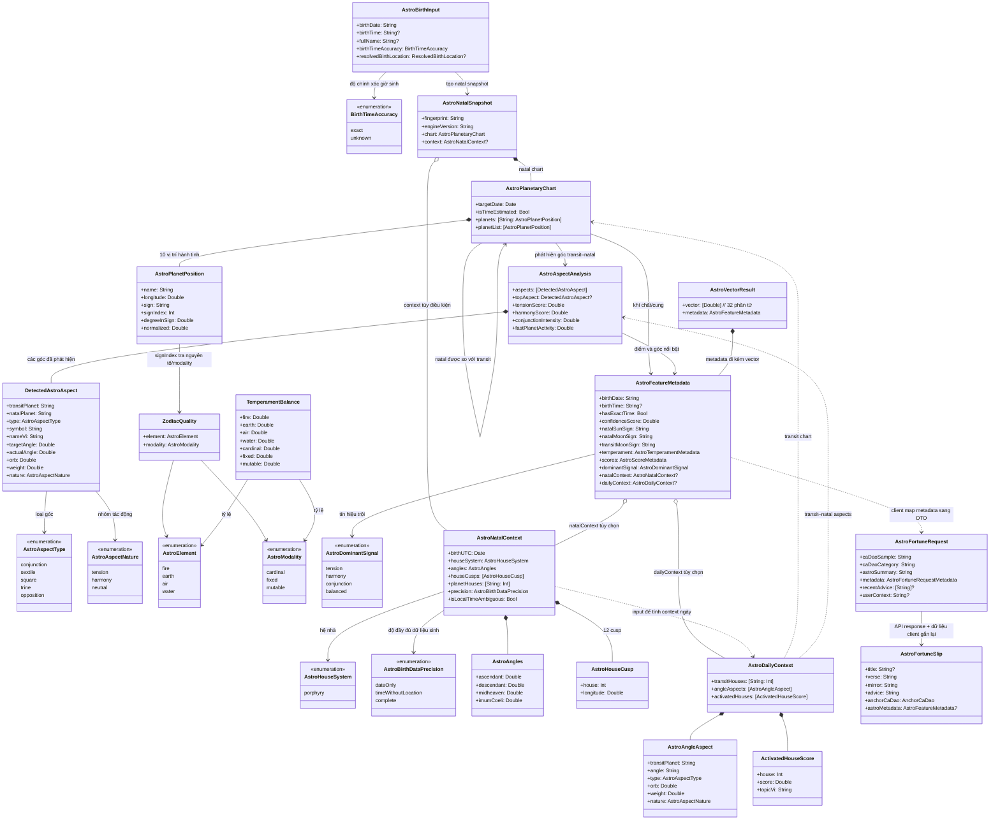

# Astrology — tài liệu chức năng và mô hình

> Tài liệu này lấy model, engine và luồng TCA trong `numelyra_app_ios/` làm nội dung chính; mã React Native chỉ được dùng để đối chiếu hành vi migration. Phần Nhà/ASC/MC và vị trí sinh là phần mở rộng của engine Swift, không phải dữ liệu đã có trong pipeline vector React Native ban đầu.

## 1. Chức năng chính

Astrology tạo lá thăm chiêm tinh hằng ngày theo hồ sơ sinh. Màn hình kết hợp dữ liệu thiên văn tính trên thiết bị với nội dung diễn giải từ API:

1. Đọc hồ sơ đang hoạt động: ngày sinh, giờ sinh tùy chọn, tên và địa điểm sinh đã phân giải (nếu có).
2. Tính natal chart (bản đồ sao lúc sinh) và transit chart (bầu trời ngày đang xem) cho 10 thiên thể Sun → Pluto.
3. So sánh transit với natal để tìm các góc chiếu, tính cân bằng nguyên tố/tính chất và tạo vector chiêm tinh 32 chiều. 32 giá trị theo đúng thứ tự là: confidence (1), kinh độ chuẩn hóa của 10 hành tinh natal (10), 10 hành tinh transit (10), tỷ lệ 4 nguyên tố (4), tỷ lệ 3 tính chất (3), và 4 điểm góc chiếu (4). Bảng index đầy đủ ở mục 3.3.

   **Ví dụ:** vector minh họa được nhóm theo thứ tự trên (các số chỉ để minh họa, không phải lá số thực):

   ```text
   confidence:             [1.00]
   10 natal (Sun → Pluto): [0.25, 0.70, 0.11, 0.42, 0.33, 0.91, 0.67, 0.52, 0.80, 0.75]
   10 transit:             [0.55, 0.13, 0.62, 0.28, 0.49, 0.78, 0.21, 0.36, 0.44, 0.58]
   4 nguyên tố:            [0.30, 0.20, 0.30, 0.20]  // Lửa, Đất, Khí, Nước
   3 tính chất:            [0.40, 0.30, 0.30]        // Tiên phong, Kiên định, Linh hoạt
   4 điểm góc chiếu:       [0.60, 0.40, 0.20, 0.70]  // Tension, harmony, conjunction, fast-planet activity
   ```

   Chẳng hạn, `0.25` ở chiều Mặt Trời natal là kinh độ chuẩn hóa (`0.25 × 360° = 90°`); `0.30` ở tỷ lệ Lửa nghĩa là 3 trong 10 hành tinh natal thuộc cung nguyên tố Lửa; `0.60` ở điểm tension là điểm căng thẳng tổng hợp từ các góc transit–natal.
4. Chọn một bài ca dao trong SQLite `cadao.db` làm chất liệu mẫu cho phần thơ. App gửi nội dung/nhóm ca dao cùng tóm tắt chiêm tinh, điểm số và tối đa 7 lời khuyên gần nhất tới `POST /api/astro/fortune`. Ca dao cung cấp mẫu tiếng Việt quen thuộc về nhịp, vần và sắc thái dân gian để AI dựa vào khi viết; nếu không có mẫu, AI thường dễ trả về văn xuôi hoặc câu thơ chưa tự nhiên. Đây là dữ liệu gợi ý cho backend, không phải bảo đảm rằng mọi câu AI sinh ra sẽ đúng niêm luật.
5. Hiển thị lá thăm gồm tiêu đề và thơ; **Gương soi** diễn giải trạng thái/tâm thế có thể liên quan đến các dấu hiệu trong ngày, còn **Kế sách** đưa ra một việc hoặc cách ứng xử cụ thể. Nút **Xem giải mã** mở sheet giải thích lá thăm và cho xem các dữ liệu chiêm tinh làm ngữ cảnh: cung Mặt Trời/Mặt Trăng, khí chất, Mặt Trăng transit, góc nổi bật, điểm số và ca dao.
6. Cache kết quả theo ngày và hồ sơ; tự làm mới khi đổi hồ sơ/ngày hoặc qua nửa đêm. Hỗ trợ thử lại bỏ qua cache và chia sẻ nội dung.

Đường đi TCA: `AstrologyView` → `AstrologyFeature` → `AstrologyClient` (`@Dependency`) → engine thuần `AstrologyEngine`; API, cache, hồ sơ, ca dao và haptic nằm ở client/dependency, không gọi side effect từ View.

### Catalog rule chiêm tinh

`Resources/AstrologyRules.v1.json` chứa 489 components. `AstrologyRuleCatalog` giải mã và xác thực coverage, provenance từng content fragment, binding, ngưỡng temperament và sự khớp giữa `ruleId` với conditions. `AstrologyRuleEvaluator` nhận chart facts từ engine, kết hợp pair transit–natal với modifier góc, dùng trọng số aspect của engine (đã tính orb), bỏ qua rule nhà khi giờ/nơi sinh chưa đạt precision `.complete`, rồi gộp tín hiệu theo chủ đề thành tối đa ba topic có payload và `matchedRuleIds`.

Evaluator tạo kết quả cục bộ trong metadata chiêm tinh. Sheet **Giải mã** có mục **Request data mới · xem trước** để xem JSON gồm payload hiện tại và `ruleContext` (catalog ID/schema, tối đa ba topic, rule IDs). JSON này không được nối vào `AstroFortuneRequest` và thao tác mở preview không gọi API. Profile temperament/ngưỡng mang nhãn `INFR`; provenance có chapter/page range ở mức mục lục cho một số nhóm, nhưng trang entry riêng cho từng diễn giải chưa được xác minh. Xem [chiến lược rule](Astrology_Rule_Strategy.md) để biết ngưỡng và giới hạn provenance.

## 2. Sơ đồ lớp và luồng dữ liệu



### Tầng model

| Nhóm | Model | Vai trò |
| --- | --- | --- |
| Input | `AstroBirthInput` | Dữ liệu sinh nội bộ đưa vào engine; vị trí sinh đã phân giải chỉ dùng local. |
| Chart | `AstroPlanetPosition`, `AstroPlanetaryChart` | Vị trí 10 thiên thể ở natal/transit. |
| Góc chiếu | `AstroAspectDefinition`, `DetectedAstroAspect`, `AstroAspectAnalysis` | Quy tắc góc chuẩn, từng góc được phát hiện và kết quả tổng hợp. |
| Bản mệnh | `ZodiacQuality`, `TemperamentBalance`, `AstroTemperamentMetadata` | Tỷ trọng nguyên tố và modality của 10 hành tinh natal. |
| Context bổ sung Swift | `AstroNatalContext`, `AstroDailyContext`, `AstroNatalSnapshot`, `AstroHouseCusp`, `AstroAngles`, `AstroAngleAspect`, `ActivatedHouseScore` | Nhà Porphyry, ASC/DC/MC/IC, nhà chứa hành tinh và nhà được kích hoạt; có thể thiếu khi dữ liệu sinh không đủ. |
| Kết quả engine | `AstroFeatureMetadata`, `AstroScoreMetadata`, `AstroVectorResult` | Metadata giải thích được và vector 32 số. |
| Ranh giới API | `AstroFortuneRequest`, `AstroFortuneRequestMetadata`, `AstroFortuneResponse` | Payload gửi/nhận server; không đồng nhất với domain model. |
| Kết quả nghiệp vụ | `AnchorCaDao`, `AstroFortuneSlip` | Nội dung hiển thị và snapshot ca dao đã dùng. |

## 3. Giải thích các trường

### 3.1 Input và chart

| Model.field | Kiểu | Ý nghĩa / quy tắc |
| --- | --- | --- |
| `AstroBirthInput.birthDate` | `String` | Ngày sinh; parser hỗ trợ format được engine chấp nhận (baseline RN ghi nhận `YYYY-MM-DD` hoặc `DD/MM/YYYY`). |
| `birthTime` | `String?` | Giờ địa phương `HH:mm`; thiếu giờ thì natal chart dùng giờ ước lượng và giảm confidence. |
| `fullName` | `String?` | Tên để định danh hồ sơ/context; không phải tham số thiên văn. |
| `birthTimeAccuracy` | `BirthTimeAccuracy` | Chất lượng/nguồn giờ sinh, dùng để phân biệt độ chính xác đầu vào. |
| `resolvedBirthLocation` | `ResolvedBirthLocation?` | Địa điểm đã tra thành tọa độ; giữ local cho phép tính nhà/ASC, không gửi nguyên object vị trí lên API. |
| `AstroPlanetaryChart.targetDate` | `Date` | Thời điểm chart được tính. |
| `isTimeEstimated` | `Bool` | `true` khi natal chart cần giờ mặc định/ước lượng vì thiếu giờ sinh. |
| `planets` / `planetList` | dictionary / array | Cùng 10 vị trí; dictionary tra theo tên, array giữ thứ tự Sun → Pluto để tính toán. |
| `AstroPlanetPosition.name` | `String` | Tên thiên thể tiếng Anh chuẩn: Sun, Moon, Mercury, Venus, Mars, Jupiter, Saturn, Uranus, Neptune, Pluto. |
| `longitude` | `Double` | Kinh độ hoàng đạo `[0, 360)` tính bằng độ. |
| `sign`, `signIndex` | `String`, `Int` | Cung hoàng đạo và index `0...11` (Aries → Pisces). |
| `degreeInSign` | `Double` | Độ nằm trong cung, `[0, 30)`. |
| `normalized` | `Double` | `longitude / 360`, chuẩn hóa về `[0, 1)`. |

### 3.2 Góc chiếu và điểm

Các aspect chính: conjunction 0° (orb 8°, neutral, trọng số 1.0), sextile 60° (5°, harmony, 0.7), square 90° (7°, tension, 1.0), trine 120° (7°, harmony, 0.9), opposition 180° (8°, tension, 1.0).

`AstroAspectType` và `AstroAspectNature` không thay thế nhau:

- `AstroAspectType` trả lời **“hai hành tinh tạo góc hình học nào?”**: `conjunction`, `sextile`, `square`, `trine` hoặc `opposition`.
- `AstroAspectNature` trả lời **“engine xếp tác động của góc này vào nhóm nào để tính điểm?”**: `tension`, `harmony` hoặc `neutral`.

Ví dụ: `square` là **type** của góc 90° và có **nature** là `tension`; `trine` là type 120° và nature `harmony`; `conjunction` là type 0° nhưng nature `neutral` trong ruleset hiện tại. Conjunction vẫn được tính riêng vào `conjunctionIntensity`, không cộng như tension hay harmony. Vì vậy mỗi `DetectedAstroAspect` giữ cả `type` lẫn `nature`.

| Model.field | Ý nghĩa |
| --- | --- |
| `AstroAspectDefinition.type/symbol/nameVi` | ID, ký hiệu và nhãn tiếng Việt của góc. |
| `targetAngle`, `maxOrb`, `baseWeight`, `nature` | Góc lý tưởng, sai số tối đa, trọng số cơ sở và loại tác động. |
| `DetectedAstroAspect.transitPlanet`, `natalPlanet` | Cặp thiên thể đang được so sánh; transit là bầu trời ngày hiện tại. |
| `actualAngle` | Khoảng cách góc ngắn nhất `[0, 180]`. |
| `orb` | `abs(actualAngle - targetAngle)`; chỉ nhận góc khi không vượt `maxOrb`. |
| `weight` | `baseWeight * max(0, 1 - orb / maxOrb)`; orb càng nhỏ thì trọng số càng lớn. |
| `AstroAspectAnalysis.aspects` / `topAspect` | Danh sách góc hợp lệ đã xếp ưu tiên và góc đứng đầu; top ưu tiên trọng số sau khi nhân hoạt tính hành tinh transit, sau đó orb nhỏ. |
| `tensionScore`, `harmonyScore` | Tỷ phần tension/harmony trong tổng trọng số directional; nếu không có directional aspect thì bằng 0. |
| `conjunctionIntensity` | Trọng số conjunction / tổng hoạt động có trọng số. |
| `fastPlanetActivity` | Phần hoạt động do Sun, Moon, Mercury, Venus, Mars tạo ra. |

Hoạt tính transit: Moon `1.0`; Sun/Mercury/Venus/Mars `0.85`; Jupiter/Saturn `0.45`; Uranus/Neptune/Pluto `0.25`. Các score được chặn trong `[0,1]` và làm tròn 4 chữ số.

### 3.3 Khí chất, metadata và vector

`TemperamentBalance` có `fire`, `earth`, `air`, `water`, `cardinal`, `fixed`, `mutable`. Mỗi trường là tỷ lệ số hành tinh natal thuộc nhóm tương ứng chia tổng 10 hành tinh. Bốn tỷ lệ nguyên tố và ba tỷ lệ modality được tính độc lập, mỗi nhóm có tổng xấp xỉ 1.

`AstroFeatureMetadata` gồm:

- Dữ liệu nguồn: `birthDate`, `birthTime`, `hasExactTime`, `confidenceScore`, `currentDateIso`.
- Cung: `natalSunSign`, `natalMoonSign`, `transitMoonSign`.
- Bản mệnh: `temperament.balance`, `dominantElement`, `dominantModality`.
- Động lực ngày: `topAspect`, `totalAspectsCount`, `scores` (`tension`, `harmony`, `conjunction`, `fastPlanetActivity`), `dominantSignal`, `vibeSummary`.
- Phần mở rộng Swift optional: `birthDataPrecision`, `natalContext`, `dailyContext`.

`confidenceScore` là `1.0` khi có giờ sinh đủ chính xác và `0.7` cho chart giờ ước lượng. `dominantSignal` chọn `conjunction` nếu conjunction ≥ `0.28`; nếu không, tension hoặc harmony thắng bên kia ít nhất `0.2`; còn lại là `balanced`. `vibeSummary` là câu deterministic tương ứng signal, không phải output AI.

Vector luôn có 32 `Double`, từng giá trị làm tròn 4 chữ số và clamp vào `[0,1]`. Index bắt đầu từ 0; thứ tự 10 hành tinh ở cả natal và transit là Sun, Moon, Mercury, Venus, Mars, Jupiter, Saturn, Uranus, Neptune, Pluto:

| Index | Chiều / giá trị được encode |
| ---: | --- |
| 0 | Confidence của giờ sinh: `1.0` nếu giờ sinh chính xác, `0.7` nếu dùng giờ ước lượng. |
| 1 | Kinh độ chuẩn hóa Mặt Trời natal (`natal Sun longitude / 360`). |
| 2 | Kinh độ chuẩn hóa Mặt Trăng natal. |
| 3 | Kinh độ chuẩn hóa Sao Thủy natal. |
| 4 | Kinh độ chuẩn hóa Sao Kim natal. |
| 5 | Kinh độ chuẩn hóa Sao Hỏa natal. |
| 6 | Kinh độ chuẩn hóa Sao Mộc natal. |
| 7 | Kinh độ chuẩn hóa Sao Thổ natal. |
| 8 | Kinh độ chuẩn hóa Sao Thiên Vương natal. |
| 9 | Kinh độ chuẩn hóa Sao Hải Vương natal. |
| 10 | Kinh độ chuẩn hóa Sao Diêm Vương natal. |
| 11 | Kinh độ chuẩn hóa Mặt Trời transit. |
| 12 | Kinh độ chuẩn hóa Mặt Trăng transit. |
| 13 | Kinh độ chuẩn hóa Sao Thủy transit. |
| 14 | Kinh độ chuẩn hóa Sao Kim transit. |
| 15 | Kinh độ chuẩn hóa Sao Hỏa transit. |
| 16 | Kinh độ chuẩn hóa Sao Mộc transit. |
| 17 | Kinh độ chuẩn hóa Sao Thổ transit. |
| 18 | Kinh độ chuẩn hóa Sao Thiên Vương transit. |
| 19 | Kinh độ chuẩn hóa Sao Hải Vương transit. |
| 20 | Kinh độ chuẩn hóa Sao Diêm Vương transit. |
| 21 | Tỷ lệ nguyên tố Lửa trong 10 hành tinh natal. |
| 22 | Tỷ lệ nguyên tố Đất trong 10 hành tinh natal. |
| 23 | Tỷ lệ nguyên tố Khí trong 10 hành tinh natal. |
| 24 | Tỷ lệ nguyên tố Nước trong 10 hành tinh natal. |
| 25 | Tỷ lệ tính chất Tiên phong (Cardinal) trong 10 hành tinh natal. |
| 26 | Tỷ lệ tính chất Kiên định (Fixed) trong 10 hành tinh natal. |
| 27 | Tỷ lệ tính chất Linh hoạt (Mutable) trong 10 hành tinh natal. |
| 28 | Điểm tension (căng thẳng) của các góc transit–natal. |
| 29 | Điểm harmony (hài hòa) của các góc transit–natal. |
| 30 | Cường độ conjunction (trùng tụ) của các góc transit–natal. |
| 31 | Tỷ trọng hoạt động do các hành tinh nhanh tạo ra (Sun, Moon, Mercury, Venus, Mars). |

`float32Values` là biểu diễn tính toán dẫn xuất; `[Double]` mới là dữ liệu được encode.

### 3.4 Nhà và góc trong bản Swift

`AstroNatalContext` chứa `birthUTC`, `houseSystem` (hiện là Porphyry), `angles`, `houseCusps`, `planetHouses`, `precision` và `isLocalTimeAmbiguous`. `AstroAngles` là kinh độ ASC, DC, MC, IC; DC đối ASC 180° và IC đối MC 180°, nên chỉ có hai cặp trục độc lập. `AstroHouseCusp` là số nhà và kinh độ đỉnh nhà. `planetHouses` ánh xạ tên hành tinh sang nhà 1–12. `AstroDailyContext` giữ nhà của các transit, góc transit tới ASC và MC (`angleAspects`; engine hiện không xét DC/IC riêng) và danh sách tối đa ba `activatedHouses` có điểm cùng chủ đề tiếng Việt.

**`AstroNatalContext` được dùng trong luồng iOS như sau:** `AstrologyEngine.makeNatalSnapshot` chỉ tạo context khi ngày/giờ sinh được resolve với precision `.complete` và có `resolvedBirthLocation` (tọa độ cùng timezone). Engine tính ASC/DC/MC/IC, 12 cusp nhà và nhà của từng hành tinh natal; snapshot được cache theo hồ sơ và phiên bản engine. Khi `generateVector` tạo kết quả ngày, context natal này được dùng để tính `AstroDailyContext`: nhà của transit hôm nay, góc transit với ASC/MC và ba nhà được kích hoạt nổi bật. Sau đó cả natal/daily context đi vào `AstroFeatureMetadata`, và `AstrologyClient.makeRequest` chọn ra ASC/MC sign, hệ nhà, nhà hành tinh, nhà được kích hoạt và góc nổi bật gửi lên API.

Hiện tại `AstrologyInsightSheetView` chưa render trực tiếp ASC/MC hoặc các nhà; những phần nó hiển thị gồm cung Mặt Trời/Mặt Trăng, khí chất, Mặt Trăng transit, top aspect và ba điểm. Vì vậy `AstroNatalContext` hiện chủ yếu phục vụ phép tính daily context và bổ sung dữ liệu cho API, chưa phải một mục hiển thị riêng trong sheet. Nếu thiếu giờ/vị trí sinh đủ chính xác, context là `nil`, nhưng chart 10 hành tinh, vector và các phần giải mã không cần nhà vẫn được tạo bình thường.

Đây là mở rộng mới của engine Swift; không được giả định rằng vector hoặc API React Native cũ đã chứa nhà/ASC/MC. Tọa độ sinh được xử lý nội bộ; API chỉ nhận các summary/highlight đã chọn.

## 4. Cách tính được áp dụng

1. **Chuẩn hóa đầu vào:** parse ngày/giờ; xác định `BirthTimeAccuracy`. Nếu không có giờ sinh, engine tạo natal chart ước lượng và gắn precision/confidence thấp hơn. Nếu có tọa độ sinh và thời gian đủ dùng, tạo thêm natal context với nhà Porphyry.
2. **Tính vị trí thiên thể:** AstronomyKit/Don Cross Astronomy Engine tạo vị trí địa tâm của 10 thiên thể; lấy kinh độ hoàng đạo rồi suy ra cung, index, độ trong cung và normalized. Phép tính chạy local/offline.
3. **Tính natal và transit:** natal dùng dữ liệu sinh đã resolve; transit dùng ngày đang xem. Cả hai chart có cùng tập/thứ tự hành tinh.
4. **Đếm khí chất:** tra bảng cung → nguyên tố/modality, đếm trên 10 hành tinh natal, chia tổng số hành tinh.
5. **Phát hiện góc:** duyệt từng cặp `transitPlanet × natalPlanet`; lấy góc nhỏ nhất; so với 5 góc chuẩn và giới hạn orb; tính weight theo orb và trọng số hành tinh transit.
6. **Tổng hợp điểm và metadata:** tính top aspect, 4 scores, signal trội, cung Mặt Trời/Mặt Trăng và câu `vibeSummary`. Nếu có natal context, tính nhà quá cảnh, góc với ASC/MC và nhà kích hoạt.
7. **Tạo vector:** đóng 32 giá trị theo bảng index trên, làm sạch NaN/missing, clamp `[0,1]` và giữ metadata để giải thích.
8. **Tạo lá thăm:** client lấy ca dao theo ngày (fallback ca dao có sẵn nếu không tìm thấy), lấy lời khuyên các ngày gần nhất, tạo DTO request và gọi API. Kết quả server được validate; client gắn lại snapshot ca dao và metadata trước khi cache/hiển thị.

### 4.1 Vì sao ca dao được gửi cùng request

Trong bản iOS, `CaDaoDatabaseService` chọn một bài từ bảng `cadao` theo ngày bằng seed `(ngày × 31 + tháng × 37 + năm × 7) % tổng_số_bài`. Vì vậy một ngày cho cùng một thiết bị/database sẽ chọn ổn định cùng một bài. Database đang bundle có 16.521 bản ghi tại thời điểm kiểm tra. Nếu database không đọc được hoặc không có dữ liệu, client dùng câu fallback.

Client gửi `caDaoSample` và `caDaoCategory` cùng với `astroSummary` và `metadata`. Ý tưởng là tách hai phần: dữ liệu chiêm tinh quyết định **nội dung cần luận giải** (ví dụ ngày nhiều góc căng thì khuyên chậm lại, rà rủi ro); ca dao cho AI **mẫu cách diễn đạt** (nhịp lục bát, vị trí gieo vần và sắc thái dân gian). `recentAdvice` giúp tránh lặp lời khuyên đã đưa trong tối đa 7 ngày trước. Code client xác nhận những trường được gửi; prompt và quy tắc sinh thơ thực tế nằm ở backend nên không thể kết luận chỉ từ app rằng backend luôn tuân thủ vần/nhịp.

**Ví dụ luận giải:** trong database có bài “Thương nhau củ ấu cũng tròn / Ghét nhau thì quả bồ hòn cũng vuông”. Cặp này cho thấy câu 6 tiếng nối với câu 8 tiếng; tiếng cuối câu sáu (“tròn”) hiệp vần với tiếng thứ sáu câu tám (“hòn”). Nếu metadata hôm nay cho thấy tension cao, AI có thể giữ ý “đừng vội, tháo gỡ bất đồng” rồi viết mới theo nhịp tương tự:

```text
Việc hôm nay chớ vội vàng,
Giữ tâm sáng tỏ, nhẹ nhàng bước đi.
Đường xa chớ ngại điều chi,
Kiên tâm rồi sẽ có khi an lành.
```

Trong ví dụ này, `vàng` hiệp vần với `nhàng` ở tiếng thứ sáu câu tám; `đi` nối vần với `chi`, rồi `chi` nối tiếp với `khi` ở tiếng thứ sáu câu tám kế tiếp. Đây là ví dụ minh họa cách dùng khuôn nhịp/vần để diễn đạt lời khuyên; không phải thơ do API trả về hay bảo đảm chất lượng cho mọi lần sinh. `mirror` có thể giải thích xu hướng nóng vội, còn `advice` chuyển ý thơ thành hành động cụ thể, chẳng hạn chọn một việc quan trọng và rà rủi ro trước khi quyết định.

## 5. Output

### Output của engine

- `AstroVectorResult`: vector 32 phần tử và `AstroFeatureMetadata`.
- `AstroAspectAnalysis`: danh sách các góc hợp lệ, góc nổi bật và 4 điểm tổng hợp.
- `AstroNatalSnapshot`: chart bản mệnh có `fingerprint`, `engineVersion` và context nhà nếu tính được; dùng để cache/invalidate theo phiên bản engine.
- Metadata mở rộng daily: các nhà được transit đi qua, góc với góc trục và nhà được kích hoạt.

### API request

`AstroFortuneRequest` gửi `caDaoSample`, `caDaoCategory`, `astroSummary`, `metadata`, `recentAdvice` tối đa 7 mục (có thể nil) và `userContext` (có thể nil). Metadata gồm tension/harmony/conjunction, dominant signal/elements và highlights; Swift có thể bổ sung độ chính xác dữ liệu sinh, hệ nhà, cung ASC/MC, nhà hành tinh và activated houses. Không gửi raw resolved birth location.

### API/client domain output

API response phải có `success = true` cùng `fortune` hợp lệ: `title?`, `verse`, `mirror`, `advice`; lỗi HTTP hoặc payload không hợp lệ được chuyển thành lỗi để màn hình hiện trạng thái thử lại. Client dựng `AstroFortuneSlip` bằng response và gắn `anchorCaDao` + `astroMetadata` từ dữ liệu request.

### Output người dùng nhìn thấy

- Màn chính: ngày hiện tại, tên biểu tượng chòm sao, tiêu đề quẻ, thơ, nút chia sẻ và nút mở giải mã.
- **Gương soi tâm trí (`mirror`)**: phần tự nhìn lại cảm xúc, phản ứng hoặc hoàn cảnh bên trong; nối lời quẻ với xu hướng chiêm tinh trong ngày. Đây là diễn giải gợi suy ngẫm, không phải một sự kiện chắc chắn sẽ xảy ra.
- **Kế sách bỏ túi (`advice`)**: gợi ý hành động thực tế cho ngày đó. Nên cụ thể và làm được, ví dụ “rà lại một rủi ro trước khi chốt việc”, thay vì chỉ nhắc chung chung “hãy cố gắng”.
- **Sheet “GIẢI MÃ CHIÊM TINH”**: sheet trượt lên khi nhấn `Xem giải mã`. Đây là phần giải thích đi kèm cùng lá thăm, không phải một lá thăm khác. Sheet luôn có hai thẻ văn bản trên; khi có metadata, nó bổ sung ngày/giờ sinh đã dùng, Mặt Trời và Mặt Trăng bản mệnh, khí chất nổi trội, Mặt Trăng quá cảnh, góc chiếu hàng đầu (hành tinh transit · tên góc · hành tinh natal, góc thực tế và sai số), ba thanh `Hài hòa`/`Thử thách`/`Hội tụ`, request JSON xem trước ở chế độ cục bộ, rồi ca dao neo quẻ.

**Ví dụ minh họa một kết quả:**

> **Quẻ:** Giữ nhịp giữa ngày nhiều áp lực  
> **Thơ:** “Việc hôm nay chớ vội vàng, / Giữ tâm sáng tỏ, nhẹ nhàng bước đi. / Đường xa chớ ngại điều chi, / Kiên tâm rồi sẽ có khi an lành.”  
> **Gương soi tâm trí:** “Có thể bạn đang muốn giải quyết mọi việc thật nhanh. Khi áp lực tăng, phản ứng vội vàng dễ làm một bất đồng nhỏ trở nên lớn hơn.”  
> **Kế sách bỏ túi:** “Chọn một việc quan trọng nhất, ghi lại một rủi ro cần kiểm tra, rồi mới quyết định. Với việc chưa gấp, cho mình thời gian suy nghĩ thêm.”

Khi nhấn **Xem giải mã**, ví dụ sheet có thể trình bày thêm:

| Mục trong sheet | Ví dụ minh họa |
| --- | --- |
| Lá số bản mệnh | Mặt Trời: Kim Ngưu ♉ · Mặt Trăng: Cự Giải ♋ · Khí chất: Nước · Tiên phong |
| Bầu trời hôm nay | Mặt Trăng quá cảnh: Xử Nữ ♍ · Góc nổi bật: Sao Hỏa · Vuông góc · Mặt Trăng · Góc 91° · Sai số 1.0° |
| Điểm chiêm tinh | Hài hòa 40% · Thử thách 60% · Hội tụ 20% |
| Ca dao neo quẻ | “Thương nhau củ ấu cũng tròn / Ghét nhau thì quả bồ hòn cũng vuông” · Vũ trụ, con người và xã hội |

Các con số/tên cung trong bảng trên chỉ mô tả cách sheet trình bày; ví dụ không phải một kết quả được tính đồng bộ từ vector mẫu. Nếu metadata chưa có, sheet vẫn hiện `Gương soi` và `Kế sách` nhưng ẩn các khối lá số/bầu trời; phần ca dao hiện khi có nội dung neo.

- Các trạng thái loading, lỗi + `Thử lại`, cached, và rollover ngày đều được xử lý bởi feature lifecycle.

## 6. File nguồn và tài liệu liên quan

**React Native baseline:**

- `numelyra_app/src/screens/AstrologyScreen.tsx`
- `numelyra_app/src/services/astro/astroEngine.ts`
- `numelyra_app/src/services/astro/aspectCalculator.ts`
- `numelyra_app/src/services/astro/astroVectorEngine.ts`
- `numelyra_app/src/services/astro/astroFortuneService.ts`
- `numelyra_app/src/features/astrology/dailyAstroFortune.ts`
- `numelyra_app/src/features/astrology/useDailyAstroFortune.ts`
- `numelyra_app/src/features/astrology/AstrologyInsightSheet.tsx`

**Swift implementation:**

- `numelyra_app_ios/numelyra_app_ios/Shared/Models/Astrology.swift`
- `numelyra_app_ios/numelyra_app_ios/Shared/Engines/AstrologyEngine.swift`
- `numelyra_app_ios/numelyra_app_ios/Core/Clients/AstrologyClient.swift`
- `numelyra_app_ios/numelyra_app_ios/Features/Astrology/AstrologyFeature.swift`
- `numelyra_app_ios/numelyra_app_ios/Features/Astrology/AstrologyView.swift`
- `numelyra_app_ios/numelyra_app_ios/Features/Astrology/AstrologyInsightFeature.swift`
- `numelyra_app_ios/numelyra_app_ios/Features/Astrology/AstrologyInsightSheetView.swift`

**Tài liệu đối chiếu:** [`ASTROLOGY_SCREEN_SPEC.md`](../../migration/inventory/ASTROLOGY_SCREEN_SPEC.md), [`DOMAIN_MODEL_GUIDE.md`](../../migration/inventory/models/DOMAIN_MODEL_GUIDE.md), [`MODEL_CATALOG.md`](../../migration/inventory/models/MODEL_CATALOG.md), [`SWIFT_MODEL_MAP.md`](../../migration/inventory/models/SWIFT_MODEL_MAP.md).

## 7. Đánh giá độ phong phú của dữ liệu hiện tại

Nhận xét “có 32 chiều nhưng dữ liệu luận giải vẫn ít” là đúng. **32 là độ dài biểu diễn số học, không phải 32 tín hiệu ngữ nghĩa độc lập.** Trong đó 20 chiều là kinh độ chuẩn hóa của 10 hành tinh natal và 10 transit. Bảy chiều nguyên tố/modality là tỷ lệ đếm trên cùng 10 hành tinh natal. Bốn chiều cuối là điểm tổng hợp từ aspect. Vì vậy phần lớn chi tiết cụ thể về hành tinh, nhà và loại tương tác bị nén mất.

Các giới hạn thấy trực tiếp trong code iOS:

1. **Vector hiện chưa được dùng làm đầu vào cho lá thăm trong app.** `AstrologyEngine.generateVector` trả về vector và metadata, nhưng luồng `AstrologyClient.dailyFortune` chỉ lấy `.metadata` để tạo request. `AstroFortuneRequest` không có trường vector; trong Swift target hiện tại không có consumer đọc `.vector` ngoài các test kiểm tra chiều dài/range. Vì vậy vector được tính nhưng bị bỏ khỏi luồng gọi API; AI nhận metadata đã chọn lọc, không nhận cả vector.
2. **Bốn score không đo cường độ tuyệt đối.** `tension` và `harmony` được chia trên tổng hai nhóm nên nếu có góc tension/harmony, chúng cộng thành 1 dù tổng hoạt động yếu hay mạnh. `conjunction` và `fastPlanetActivity` cũng là tỷ lệ trên tổng trọng số hoạt động. Chưa có tổng trọng số hoạt động hay số góc mạnh riêng theo loại trong vector. `dominantSignal` phân loại trên các score đã nén này.
3. **Aspect chi tiết bị rút xuống ở ranh giới metadata.** Engine có thể phát hiện góc trong các cặp 10 × 10 transit–natal, nhưng `AstroFeatureMetadata` chỉ giữ `topAspect` và `totalAspectsCount`, không giữ toàn bộ danh sách aspect. Request gửi highlight được chọn và các score; UI chủ yếu hiện một góc nổi bật. Chưa có trong kết quả hiện tại các cặp natal–natal, applying/separating, thời điểm chính xác đạt góc, tốc độ/nghịch hành hoặc điểm theo từng hành tinh.
4. **Context nhà/góc có nhiều dữ liệu thô hơn phần giải nghĩa hiện dùng.** Natal context có 4 tọa độ trục, 12 house cusp và map 10 hành tinh natal vào nhà. DC/IC là điểm đối của ASC/MC, nên chỉ có hai cặp trục độc lập. Engine chỉ xét transit tới ASC và MC (orb tối đa 3°), không xét DC/IC riêng. House activation cộng trọng số transit đang ở mỗi nhà, aspect transit–natal theo nhà natal và góc ASC/MC vào nhà 1/10; sau đó chia cho điểm nhà lớn nhất và chỉ giữ ba nhà đầu. Cách chuẩn hóa tương đối không cho biết ngày đó tổng hoạt động nhà yếu hay mạnh. Request cũng chỉ gửi tối đa ba angle highlight.
5. **Cá nhân hóa theo nhà cần giờ và nơi sinh đủ chính xác.** Chỉ khi precision là `.complete` và có `resolvedBirthLocation` mới có natal context. Nếu thiếu, chart hành tinh, vector và aspect vẫn chạy, nhưng không có ASC/MC/cusp/planet houses/daily houses. UI hiện không thông báo rõ phần context nhà đang thiếu.
6. **Khí chất là phép đếm phẳng.** Mỗi trong 10 hành tinh natal đóng góp ngang nhau vào tỷ lệ nguyên tố/modality; chưa có trọng số riêng cho Sun/Moon/ASC, chủ tinh lá số, hành tinh ở góc hoặc nhà được nhấn mạnh. Đây là mô tả phân bố thô, chưa phải tổng hợp sâu về cấu trúc lá số cá nhân.

### Kết luận và hướng mở rộng hợp lý

Phần hiện tại phù hợp để tạo lá thăm ngắn, nhất quán và có vài căn cứ giải thích; chưa đủ để gọi là bản luận giải cá nhân sâu. Nút thắt chính không chỉ là “cần thêm dimension”: vector đang không được dùng, aspects bị rút gọn, house context chỉ dùng một phần và score không giữ magnitude tuyệt đối.

Nếu mục tiêu là tăng chiều sâu luận giải, nên tăng **chất lượng context có nghĩa** trước khi tăng số chiều: gửi 3–5 aspect nổi bật cùng hai hành tinh, type, orb, weight và applying/separating; thêm natal planet-in-house, transit planet-in-house và house activation có cả tổng trọng số lẫn điểm chuẩn hóa; bổ sung pha/cung/nhà Mặt Trăng và trạng thái retrograde/tốc độ khi engine hỗ trợ. Với lá số đủ giờ/nơi sinh, có thể thêm ASC/MC và chủ tinh lá số vào cách xếp ưu tiên. Đồng thời truyền confidence và chỉ rõ context nào đang thiếu.

Nên giữ vector 32 chiều nếu có consumer downstream xác định. Nếu không có use case ML/search, tăng số chiều tự nó không làm output tốt hơn. Với API tạo lời luận giải, DTO ngữ nghĩa có thứ tự ưu tiên thường hữu ích hơn gửi thêm một mảng số không có consumer.

## 8. Phạm vi audit trong slice này

Đã đọc trực tiếp các file Astrology React Native nêu ở trên để lập pipeline, model, cache/API và output; đối chiếu `Astrology.swift`, `AstrologyEngine.swift`, `AstrologyClient.swift` và các TCA/View mapping Swift. Đây là audit feature Astrology và tài liệu hóa implementation hiện hữu, không thay thế runtime validation toàn dự án hoặc kiểm tra parity trên Simulator.

## 9. Rule catalog v1

Rule catalog v1 là JSON tĩnh được bundle cùng ứng dụng tại `Resources/AstrologyRules.v1.json`. Catalog dùng tropical zodiac, Porphyry và phiên bản engine `astrology-v3-porphyry-1`; profile diễn giải là `modern_psychological`.

Catalog có 489 rule components:

| Nhóm | Số lượng | Điều kiện dữ liệu |
| --- | ---: | --- |
| Cân bằng nguyên tố/tính chất | 24 | Tỷ lệ hiện engine tính từ 10 hành tinh natal |
| Hành tinh trong cung | 120 | 10 hành tinh × 12 cung |
| Hành tinh trong nhà natal | 120 | 10 hành tinh × 12 nhà; cần natal context |
| Cặp transit–natal | 100 | 10 hành tinh transit × 10 hành tinh natal |
| Modifier loại aspect | 5 | Conjunction, sextile, square, trine, opposition |
| Transit qua nhà natal | 120 | 10 hành tinh transit × 12 nhà; cần natal context |

Rule dùng các payload template và `contentLibrary` tiếng Việt có thể tái sử dụng, thay vì lưu một đoạn văn lặp cho từng tổ hợp. Mỗi component ghi `epistemicTier`, tradition, `sourceRefs`, `contentRefs`, `templateBindings`, trạng thái biên tập và cờ `requiresNatalContext`. Ngưỡng cân bằng là giả định kỹ thuật `INFR`, không phải ngưỡng được coi là đồng thuận của một trường phái.

`AstrologyRuleCatalog` giải mã, tải catalog từ bundle và kiểm tra phiên bản, tương thích engine, số lượng/độ phủ tổ hợp, ID trùng, điều kiện, template, content và nguồn tham chiếu. `AstrologyRuleEvaluator` đã được nối với chart facts do engine tính và lưu kết quả cục bộ trong metadata; UI dựng JSON preview riêng, không thêm `ruleContext` vào body `AstroFortuneRequest` hiện tại. House rules chỉ kích hoạt khi natal precision là `.complete`.

Nguồn được lưu ở mức thư mục/ấn bản và đường dẫn kiểm tra. Trạng thái bibliographic verification không xác nhận từng nội dung theo trang; các đoạn văn đều là bản diễn đạt mới và cần biên tập/đối chiếu trước khi phát hành.
